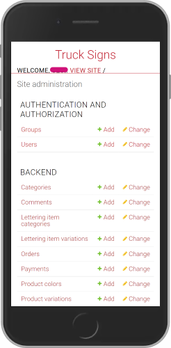
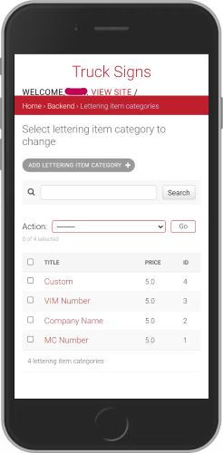
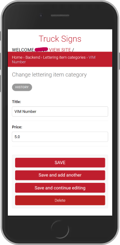
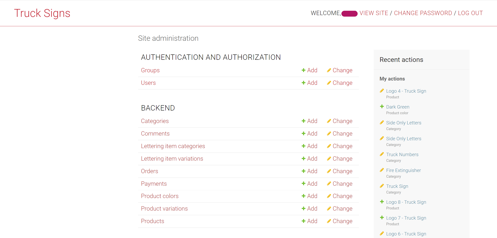
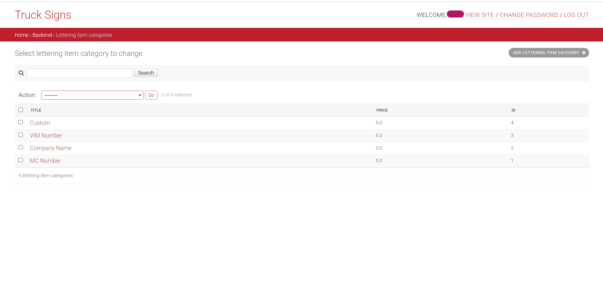
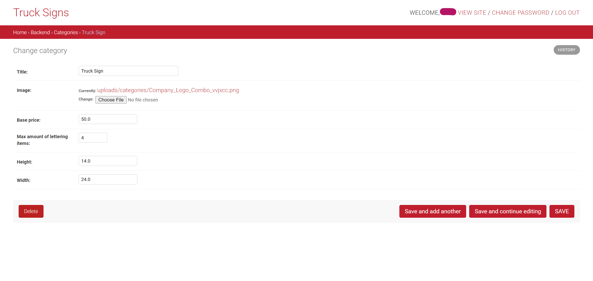

<div align="center">

# Signs for Trucks

  


__Signs for Trucks__ is an online store to buy pre-designed vinyls with custom lines of letters (often called truck letterings).
The store also allows clients to upload their own designs and to customize them on the website as well.

</div>

## Table of Contents

- [Description](#description)
- [Quickstart](#quickstart)
  - [Prerequisites](#prerequisites)
  - [Run the Stack](#run-the-stack)
  - [How to Build the Image](#how-to-build-the-image)
  - [Running without Docker](#running-without-docker)
- [Usage](#usage)
  - [Environment Variables](#environment-variables)
  - [Switching the Database with MODE](#switching-the-database-with-mode)
  - [Updating a Running Stack](#updating-a-running-stack)
  - [Container Lifecycle and Restarts](#container-lifecycle-and-restarts)
  - [Persistent Data](#persistent-data)
  - [Changing the Gunicorn Configuration](#changing-the-gunicorn-configuration)
  - [Running the Containers without Compose](#running-the-containers-without-compose)
- [Continuous Integration](#continuous-integration)
- [Repository Contents](#repository-contents)
- [Application Details](#application-details)
- [Admin Panel Screenshots](#screenshots-of-the-django-backend-admin-panel)
- [Additional Information](#additional-information)

## Description

This repository holds the backend of the Truck Signs store: a Django application with a
Django REST Framework API, served by gunicorn and backed by PostgreSQL, packaged to run
as a Docker Compose stack. The API is published on port **8020** of the host, the Django
admin interface at `/admin/`; every file of the setup is listed under
[Repository Contents](#repository-contents).

## Quickstart

### Prerequisites

* [Docker](https://docs.docker.com/get-docker/) and Docker Compose v2
* [Python 3.12](https://www.python.org/downloads/) - only needed to run the project
  outside of Docker

Verified with Docker 29.9, Docker Compose 5.6 and PostgreSQL 17-alpine.

### Run the Stack

1. Create the environment file and fill in the values. `example.env` lists every
   variable and says which ones are required:

    ```bash
    cp example.env .env
    ```

2. Start the stack:

    ```bash
    docker compose up -d
    ```

The first start builds the image, initialises the database, applies all migrations and
creates the superuser from `DJANGO_SUPERUSER_*`. Follow it with:

```bash
docker compose logs -f backend
```

The API answers once the log shows `Listening at: http://0.0.0.0:8000`. Open
<http://localhost:8020/> or, on a remote host, `http://<host-ip>:8020/` - the host
address has to be listed in `ALLOWED_HOSTS`, otherwise Django answers with
`400 Invalid HTTP_HOST header`.

Stop the stack with `docker compose down`. The data survives, see
[Persistent Data](#persistent-data).

### How to Build the Image

`docker compose up` builds the image when it is not present yet. To build it
explicitly:

```bash
docker compose build
```

The result is tagged `truck-signs-api:1.0.0`, which is set by the `image:` key in
`docker-compose.yml`. Without that key Compose would name the image after the
directory it finds the project in and tag it `latest`.

To build the image on its own, without Compose:

```bash
docker build -t truck-signs-api:1.0.0 .
```

The build context is reduced by `.dockerignore`, which keeps `.env`, `.git`, the local
SQLite database and the README screenshots out of the image.

### Running without Docker

For development against a local SQLite database, with no containers involved:

```bash
python -m venv .venv
source .venv/bin/activate        # Windows: .venv\Scripts\activate
pip install -r requirements.txt
cp example.env .env              # set MODE=dev
cd src
python manage.py migrate
python manage.py createsuperuser
python manage.py runserver
```

The development server listens on <http://localhost:8000/>. Do not run
`makemigrations`; the migrations are part of the repository.

## Usage

### Environment Variables

All configuration is read from the environment. `docker-compose.yml` takes the values
from `.env` and passes them to the containers; outside of Docker, `settings.py` reads
`.env` directly. **Only names are documented here, never values.**

| Variable | Required | Purpose |
|---|---|---|
| `DB_NAME` | yes | Database name. Compose passes it to the db service as `POSTGRES_DB`. |
| `DB_USER` | yes | PostgreSQL role the application authenticates with. Passed as `POSTGRES_USER`. |
| `DB_PASSWORD` | yes | Password for that role. Passed as `POSTGRES_PASSWORD`. |
| `DB_HOST` | yes | Has to be the name of the database service, `db`, not `localhost`. |
| `DB_PORT` | yes | PostgreSQL port, `5432`. |
| `SECRET_KEY` | yes | Signs session cookies, CSRF tokens and password reset links. |
| `ALLOWED_HOSTS` | yes | Comma separated host names and IPs the API may be addressed by. |
| `DJANGO_SUPERUSER_USERNAME` | yes | Login name of the admin account. |
| `DJANGO_SUPERUSER_EMAIL` | yes | Email address of the admin account. |
| `DJANGO_SUPERUSER_PASSWORD` | yes | Password of the admin account. |
| `MODE` | for local use | `dev` selects SQLite, `prod` selects PostgreSQL. |
| `DEBUG_ENABLED` | no | Enables Django's debug pages. See the warning below. |
| `LOG_LEVEL` | no | Verbosity of the application logger, `ERROR` by default. |
| `CORS_ALLOWED_ORIGINS` | no | Browser origins allowed to call the API. |
| `CLOUD_NAME`, `CLOUD_API_KEY`, `CLOUD_API_SECRET` | no | Cloudinary credentials. |
| `EMAIL_HOST_USER`, `EMAIL_HOST_PASSWORD` | no | SMTP credentials for outgoing mail. |

The `.env` file is listed in `.gitignore` and must never be committed. Generate a
secret key with:

```bash
python -c "from django.core.management.utils import get_random_secret_key; print(get_random_secret_key())"
```

Wrap the value in single quotes - a generated key may contain `#`, which would
otherwise start a comment and cut the key in half.

Two things to be aware of:

> [!WARNING]
> `DEBUG_ENABLED=True` does more than enable debug pages: `settings.py` then forces
> `MODE` to `dev`, which switches the database to SQLite even when `MODE=prod` is set.
> Data written in that state does not reach PostgreSQL.

`docker-compose.yml` sets `MODE=prod` and `DEBUG_ENABLED=False` directly rather than
reading them from `.env`, because they describe what this stack is rather than how a
particular environment is configured.

### Switching the Database with MODE

- `MODE=prod` - PostgreSQL, using the `DB_*` variables.
- `MODE=dev` or `MODE` unset - SQLite at `src/db.sqlite3`; the `DB_*` variables are ignored.

The container always runs in `prod`. `MODE=dev` in `.env` only affects `manage.py`
runs inside a virtual environment.

### Updating a Running Stack

Compose does not notice changes to the source code or the Dockerfile. After editing
either, rebuild explicitly:

```bash
docker compose up -d --build
```

Without `--build` the existing image is reused and the change has no effect.

### Container Lifecycle and Restarts

Both services use `restart: on-failure`. A container that exits with a non-zero code is
restarted; a container stopped on purpose stays stopped.

This also means the stack does **not** come back up by itself after a reboot of the
host. Start it again with `docker compose up -d`.

`entrypoint.sh` starts gunicorn with `exec`, so gunicorn becomes PID 1 of the container
and receives `SIGTERM` directly. `docker compose stop` therefore shuts it down
gracefully and the container exits with code 0 instead of being killed.

### Persistent Data

Two named volumes hold everything that has to survive a container being replaced:

| Volume | Mounted at | Contents |
|---|---|---|
| `postgres_data` | `/var/lib/postgresql/data` | the PostgreSQL data directory |
| `media_files` | `/app/src/mediafiles` | files uploaded through the API |

```bash
docker compose down        # removes the containers, keeps the volumes
docker compose up -d       # database and uploads are still there
docker compose down -v     # removes the volumes as well - deletes all data
```

Static files are deliberately **not** in a volume: `entrypoint.sh` runs
`collectstatic` on every start and regenerates them.

The mount point `/var/lib/postgresql/data` is tied to the major version of the image.
PostgreSQL 18 and later store their data under `/var/lib/postgresql/<version>/docker`
instead, so the image tag cannot be raised without moving the mount.

### Changing the Gunicorn Configuration

The start command lives in the last line of `entrypoint.sh`:

```bash
exec gunicorn tsa_app.wsgi:application --bind 0.0.0.0:8000
```

Add gunicorn options there, for example `--workers 4`. The common rule of thumb is
`(2 x CPU cores) + 1`. The port inside the container has to stay in sync with
`EXPOSE` in the `Dockerfile` and with the right-hand side of the port mapping in
`docker-compose.yml`.

To publish the API on a different host port, change the left-hand side only:

```yaml
    ports:
      - "8080:8000"
```

### Running the Containers without Compose

The same stack with plain Docker commands. Replace every `<placeholder>`; none of
these values belong in version control.

```bash
docker network create tsa-network

docker run -d --name tsa_db --network tsa-network \
  -e POSTGRES_DB=<db-name> \
  -e POSTGRES_USER=<db-user> \
  -e POSTGRES_PASSWORD=<db-password> \
  -v postgres_data:/var/lib/postgresql/data \
  --restart on-failure \
  postgres:17-alpine

docker build -t truck-signs-api:1.0.0 .

docker run -d --name tsa_backend --network tsa-network \
  -e MODE=prod \
  -e DEBUG_ENABLED=False \
  -e DB_NAME=<db-name> \
  -e DB_USER=<db-user> \
  -e DB_PASSWORD=<db-password> \
  -e DB_HOST=tsa_db \
  -e DB_PORT=5432 \
  -e SECRET_KEY=<secret-key> \
  -e ALLOWED_HOSTS=<host-list> \
  -e DJANGO_SUPERUSER_USERNAME=<admin-name> \
  -e DJANGO_SUPERUSER_EMAIL=<admin-email> \
  -e DJANGO_SUPERUSER_PASSWORD=<admin-password> \
  -v media_files:/app/src/mediafiles \
  -p 8020:8000 \
  --restart on-failure \
  truck-signs-api:1.0.0
```

Note that `DB_HOST` is the container name here, while Compose uses the service name
`db`. Containers only resolve each other by name inside a user-defined network, which
is why the network has to be created first.

## Continuous Integration

Three workflows live in `.github/workflows`. Quality assurance tooling is described in
more detail in [docs/testing.md](docs/testing.md).

| Workflow | Runs on | What it does |
|---|---|---|
| `test.yaml` | push to `main` and pull requests against `main`, limited to changes in `**/*.py` or `requirements.txt` | a `lint` job running `flake8`, `black --check` and `isort --check-only`, then a `test` job running `python manage.py test` with `MODE=dev` |
| `build.yaml` | git tags and manual dispatch | builds the image with Buildx and pushes it to `ghcr.io/<owner>/<repo>` tagged `latest` and with the tag name |
| `check-open-pr.yaml` | push to any branch except `main`, and when a pull request is opened | fails when the current branch has no open pull request |

Two notes on the triggers:

`test.yaml` only starts when a Python file or `requirements.txt` changed. Changes that
only touch `Dockerfile`, `entrypoint.sh`, `docker-compose.yml` or documentation do not
trigger it, and the workflow is not reported as skipped either - it simply does not
run.

`check-open-pr.yaml` enforces a process rule rather than code quality. A push to a
feature branch before the pull request exists fails by design; the run turns green once
the pull request is open.

The image name used by `build.yaml` (`ghcr.io/<owner>/<repo>`) differs from the local
name in `docker-compose.yml` (`truck-signs-api:1.0.0`). That is deliberate: the Compose
setup builds the image locally and needs no registry credentials on the host.

## Repository Contents

| Path | Purpose |
|---|---|
| `Dockerfile` | builds the application image from a pinned, slim Python 3.12 base image |
| `.dockerignore` | keeps secrets, the git history, local artefacts and the screenshots out of the build context |
| `entrypoint.sh` | container startup: wait for the database, migrate, collect static files, ensure the superuser, start gunicorn |
| `docker-compose.yml` | the two-service stack with network, volumes and port mapping |
| `example.env` | template for `.env`, lists every variable |
| `requirements.txt` | Python dependencies |
| `pyproject.toml` | configuration for `black`, `isort` and `flake8` |
| `src/` | the Django project: `tsa_app` holds the settings, `tsa_products` the models, views and serializers |
| `docs/testing.md` | linting and test tooling |
| `Truck Signs API v2 Checkliste.pdf` | the course submission checklist this repository is graded against |

## Application Details

### Models

Most of the models do what can be inferred from their name. These notes make the
purpose of some of them clearer:

- __Category:__ the category of the vinyls in the store. It contains the title of the
  category as well as the basic properties shared among products that belong to the same
  category. For example, _Truck Logo_ is a category for all vinyls that have a logo of a
  truck plus some lines of letterings. Another category is _Fire Extinguisher_.
- __Lettering Item Category:__ the category of the lettering, for example _Company Name_
  or _VIN Number_. Each has a different pricing.
- __Lettering Item Variation:__ holds a foreign key to the Lettering Item Category and
  the text added by the client.
- __Product Variation:__ has the original product as a foreign key, plus the lettering
  lines added by the client.

> [!NOTE]
> To create truck vinyls with truck logos in them, first create the __Category__
> `Truck Sign` and then the __Product__, which can have any name. The frontend only
> fetches products of the category `Truck Sign` for the product grid.

### Brief Explanation of the Views

Most of the views are class based views imported from `rest_framework.generics` and
provide the usual CRUD operations, inheriting from `ListAPIView`, `CreateAPIView`,
`RetrieveAPIView` and so on.

Some views needed different behaviour. Order creation and payment are implemented in
the same view and therefore inherit from `GenericAPIView`. `UploadCustomerImage` takes
a vinyl template uploaded by a client and creates a new product from it.

## Screenshots of the Django Backend Admin Panel

### Mobile View

<div style="padding: 0 5rem; width: 100%;  display: flex; gap: 5rem; justify-content: center; flex-wrap: wrap;">







</div>

### Desktop View

<div style="padding: 0 5rem; width: 100%; display: flex; flex-direction: column; gap: 2rem; align-items: center; justify-content: center;">







</div>

## Additional Information

- [Docker documentation](https://docs.docker.com/)
- [Compose file reference](https://docs.docker.com/reference/compose-file/)
- [Official PostgreSQL image](https://hub.docker.com/_/postgres)
- [Django documentation](https://docs.djangoproject.com/en/5.2/)
- [Django REST Framework documentation](https://www.django-rest-framework.org/)
- [Gunicorn settings](https://docs.gunicorn.org/en/stable/settings.html)
- [WhiteNoise documentation](https://whitenoise.readthedocs.io/)
- [Set up Django with Cloudinary](https://cloudinary.com/documentation/django_integration)
- [Configure CORS](https://www.stackhawk.com/blog/django-cors-guide/)
